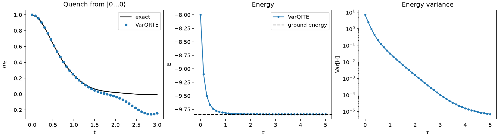

Examples
========

VarQRTE and VarQITE with McLachlan's Principle
-----------------------------------------------

This example evolves an 8-qubit transverse-field Ising chain

.. math::

   H = -J \sum_i Z_i Z_{i+1} - h \sum_i X_i, \qquad J = h = 1,

in real and imaginary time. For :math:`h < J` the ground state is ferromagnetically
ordered along :math:`Z`, for :math:`h > J` it is a paramagnet polarized along :math:`X`,
and :math:`h = J` is the quantum critical point.

At every step, McLachlan's variational principle turns the Schrödinger equation into the
linear system :math:`\mathrm{Re}(G)\,\dot\theta = b`. ``BowtieQGT`` provides :math:`G` and
:math:`b`; ``scipy.integrate.solve_ivp`` integrates :math:`\dot\theta`. A small
regularization :math:`\lambda I` takes care of the redundant directions of :math:`G`.

**Real time.** Starting from :math:`|0\ldots0\rangle` (all spins along :math:`Z`), the
transverse field rotates the spins and the magnetization :math:`m_z = \langle\sum_i
Z_i\rangle / n` relaxes to zero. The quench also builds up entanglement, which a
fixed-depth ansatz can only represent for so long. With 3 layers, VarQRTE follows the
exact curve until :math:`t \approx 1.3` and then drifts; more layers push this point later.

**Imaginary time.** Starting from :math:`|+\ldots+\rangle`, the ground state at
:math:`h \to \infty`, the energy decreases monotonically to the exact ground energy. The
variance :math:`\mathrm{Var}[H]` falls by six orders of magnitude, which certifies that the
state is an eigenstate and not just a low-energy state.

The script runs in a few minutes on a laptop. It needs ``matplotlib`` and ``scipy``. It is
also in the repository as ``docs/examples/mclachlan_ising.py``.

.. literalinclude:: ../examples/mclachlan_ising.py
   :language: python
   :lines: 24-

See Also
--------

- :doc:`quickstart`: conventions and the structure of the generalized QGT
- :doc:`api`: complete API reference
- ``test/test_bowtie_qgt.py``: checks against Qiskit's reference gradients on many circuits
